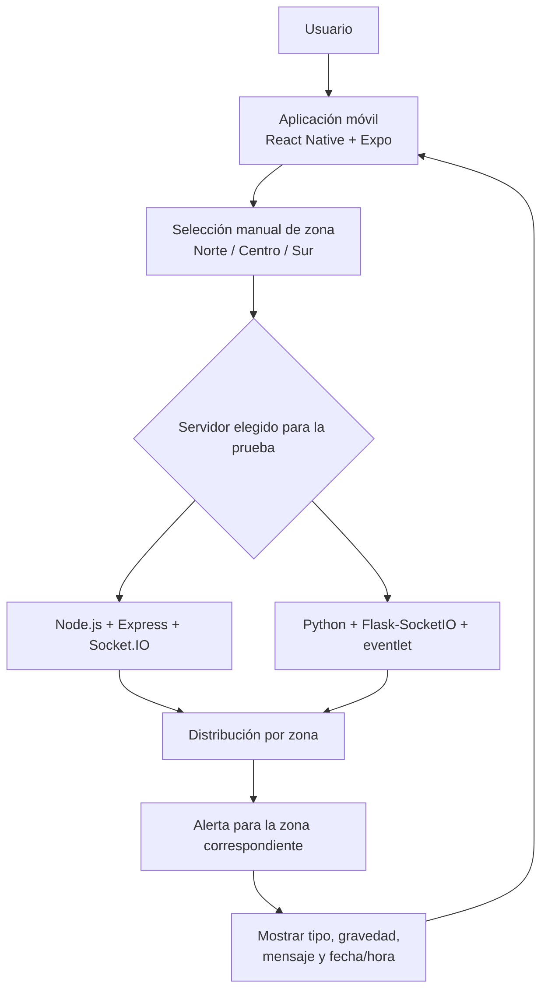

# Alertas comunitarias de emergencia

## Descripción

Aplicación móvil para seleccionar manualmente una zona —Norte, Centro o Sur— y recibir alertas comunitarias de emergencia en tiempo real.

La información prevista para cada alerta incluye el tipo de emergencia, la gravedad, el mensaje y la fecha/hora. El sistema contempla comparar dos alternativas de servidor: Node.js con Express y Socket.IO, o Python con Flask-SocketIO y eventlet. Se utilizará una alternativa a la vez para las pruebas comparativas.

## Tecnologías utilizadas

- **React Native:** desarrollo de la aplicación móvil.
- **Expo:** ejecución y prueba de la aplicación durante el desarrollo.
- **TypeScript:** lenguaje de la plantilla móvil.
- **Expo Go:** prueba de la aplicación en un teléfono compatible.
- **Node.js, Express y Socket.IO:** primera alternativa de servidor.
- **Python, Flask-SocketIO y eventlet:** segunda alternativa de servidor.
- **Git y GitHub:** control de versiones y repositorio del proyecto.
- **Visual Studio Code:** editor de código.


## Requisitos

Tener Node.js y npm instalados, además de Expo Go en el teléfono para probar la aplicación en un dispositivo físico.

## Cómo levantar el proyecto

Requisitos: Python 3.10 a 3.13, Node.js y Git. Para la app móvil, Expo Go en el celular.

Primero clonar el repositorio:

```
git clone https://github.com/Dayana200505/servicios-telematicos-api-node-flask.git
cd servicios-telematicos-api-node-flask
```

### Backend Flask (puerto 5000)

Primera vez:

```
cd flask-server
python -m venv venv
venv\Scripts\activate
pip install flask flask-socketio eventlet
python app.py
```

Siguientes veces:

```
cd flask-server
venv\Scripts\activate
python app.py
```
### Backend Node.js (puerto 3001)

```
cd node-server
npm install
npm start
```

Cliente receptor de prueba para Node.js:

```powershell
node cliente_prueba.js http://localhost:3001 norte 60000
```

En otra terminal, el emisor puede enviar todas las alertas de prueba o solo
las de una zona:

```powershell
node emisor.js http://localhost:3001
node emisor.js http://localhost:3001 norte
```

El cliente receptor muestra únicamente las alertas que llegan a la room
seleccionada, incluyendo tipo, gravedad, zona, mensaje y fecha/hora.

### App móvil (Expo Go)

1. En `mobile/src/config/env.ts`, poner la IP de la computadora en `SERVER_HOST`.
2. En el mismo archivo, dejar activo solo el puerto del servidor que se va a usar: 3001 (Node.js) o 5000 (Flask).
3. Con el backend corriendo, en otra terminal:

```
cd mobile
npm install
npx expo start
```

4. Escanear el QR con Expo Go. El celular y la computadora deben estar en la misma red WiFi.

### Probar la conexión sin celular

Con un backend corriendo, en otra terminal:

```
cd flask-server
venv\Scripts\activate
python test_client.py        # servidor Flask (puerto 5000)
python test_client_node.py   # servidor Node.js (puerto 3001)
```


## Arquitectura general

La arquitectura prevista contiene los siguientes elementos:

1. **Aplicación móvil:** interfaz desde la que los usuarios seleccionan una zona y consultan las alertas.
2. **Zonas:** Norte, Centro y Sur. La selección es manual; no se contempla utilizar GPS.
3. **Servidor:** recibe y distribuye las alertas según la zona de destino.
4. **Salas por zona:** permiten dirigir las alertas a los usuarios correspondientes.
5. **Visualización:** la aplicación presenta el tipo de emergencia, gravedad, mensaje y fecha/hora.

Se consideran dos alternativas de servidor para las pruebas:

- **Alternativa A:** Node.js + Express + Socket.IO.
- **Alternativa B:** Python + Flask-SocketIO + eventlet.

Las alternativas se prueban por separado, no simultáneamente. Los nombres definitivos de eventos, el formato de los datos, los puertos y las direcciones de conexión quedan pendientes de confirmación antes de integrar la aplicación con el servidor.



El diagrama representa la arquitectura prevista. La conexión móvil-servidor, la distribución en tiempo real y la lógica de alertas deben implementarse antes de que el flujo funcione de extremo a extremo.


### Registro de alertas en SQLite

El servidor Flask crea automáticamente la base de datos `flask-server/alertas.db`
al iniciar. La tabla `alertas` almacena:

- tipo, gravedad, zona y mensaje;
- `emitida_en`, como marca de tiempo Unix en milisegundos;
- `fecha_hora`, como fecha/hora UTC en formato ISO 8601.

Una alerta solo se difunde después de validarse y guardarse correctamente. Si
SQLite no puede registrar la alerta, el emisor recibe `error_alerta` y la alerta
no se publica a ninguna room.


```powershell
flask-server/alertas.db
```

Para comprobar los registros guardados:

```powershell
python -c "import sqlite3; c=sqlite3.connect('alertas.db'); print(*c.execute('SELECT id,tipo,gravedad,zona,mensaje,fecha_hora FROM alertas ORDER BY id DESC'), sep='\n')"
```

### Cliente de prueba funcional

El script [cliente_prueba.py](flask-server/cliente_prueba.py) conecta al
servidor, selecciona una zona y muestra en tiempo real las alertas recibidas.
Funciona con cualquiera de los dos backends:

```powershell
cd flask-server
python cliente_prueba.py http://localhost:5000 norte --duracion 60
python cliente_prueba.py http://localhost:3001 sur --duracion 60
```

Con el cliente ejecutándose, enviar una alerta desde otra terminal:

```powershell
python enviar_alerta.py http://localhost:5000 norte
```

El cliente imprime tipo, gravedad, zona, mensaje y fecha/hora. Para comprobar
que la segmentación funciona, ejecutar varios clientes con zonas diferentes y
enviar alertas usando `enviar_alerta.py`; cada cliente debe mostrar únicamente
las alertas de su zona.


### Notas

- Se levanta un solo backend a la vez con la app móvil.
- No subir al repositorio los cambios locales de `env.ts` (IP personal).

